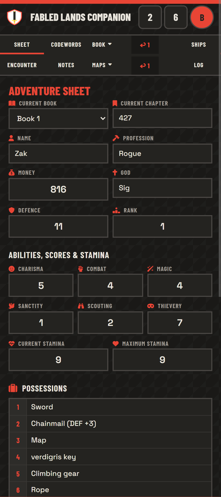
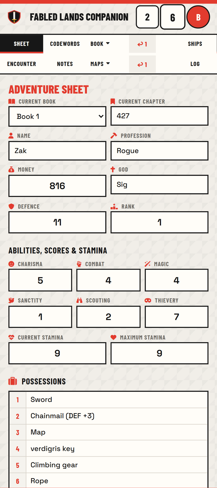
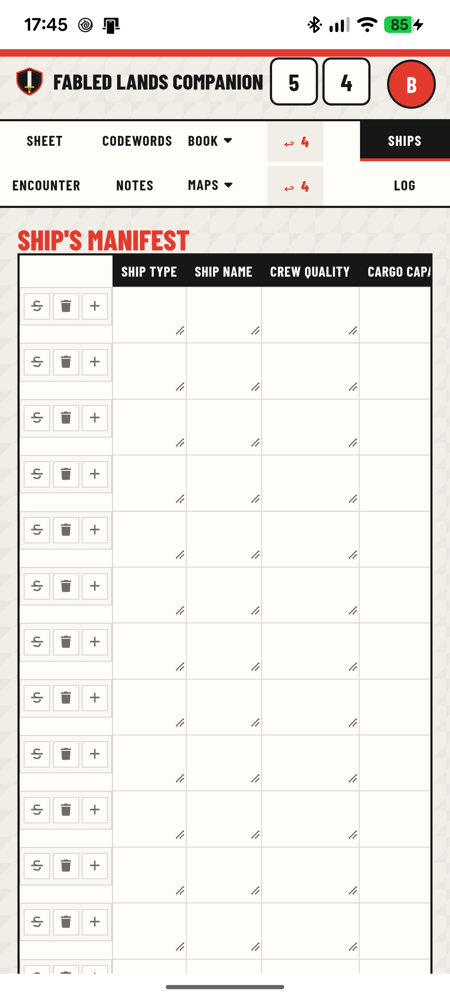
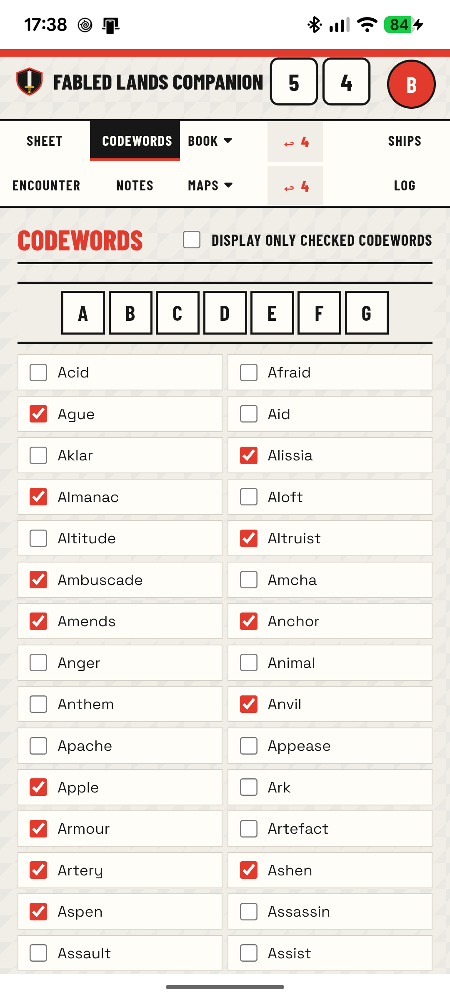
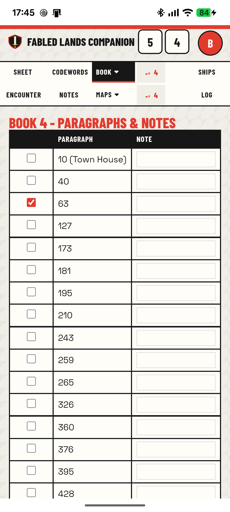
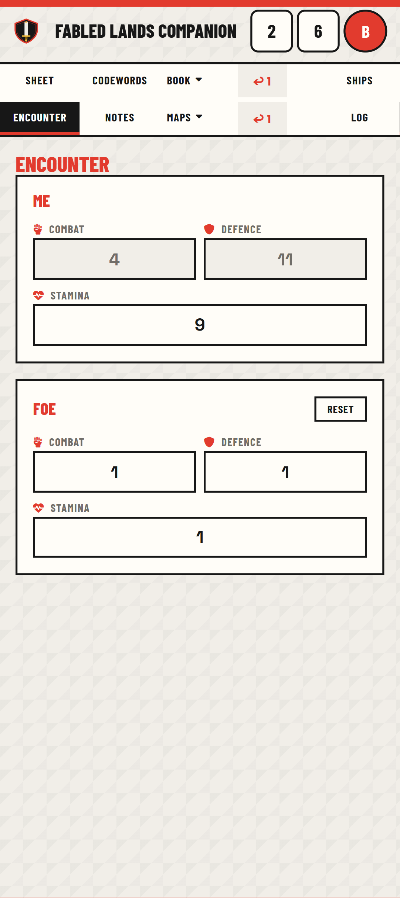
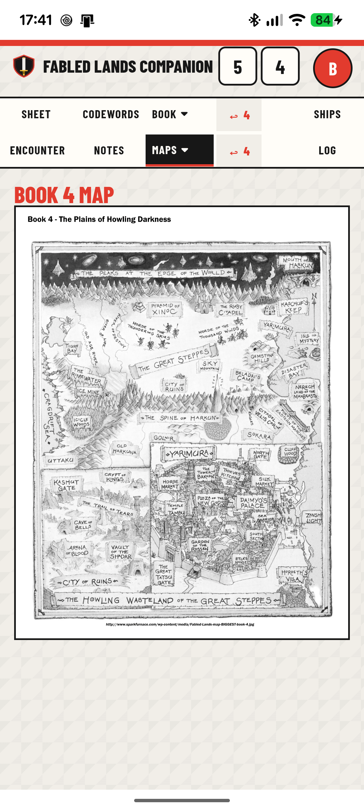

# Fabled Lands Companion

A web-based Adventure Sheet application for the **Fabled Lands** gamebook series (books 1 to 7). Designed for mobile-first use (smartphone-compatible), it replaces the paper play sheets with a fully interactive, auto-saving digital companion.

---

## Release Notes

The v1.22 release notes are described in [CHANGELOG.md](CHANGELOG.md).

## User Manual

### Getting Started

Open `index.html` in a browser. No installation is required for anonymous mode — all data is saved automatically in your browser's local storage.

If the server runs PHP, you can create an account to sync your data across devices.

### Navigation



The top of the screen features a **tab bar** for quick navigation between sections, and **two dice** next to the title for quick random rolls:

| Element | Description |
|---|---|
|  **Theme toggle** | Click to toggle between Dark theme avec Light theme. |
| **Dice** | Click either die to roll it with a 3D animation. Results are displayed as numbers (1–6). No persistence. |
| **Adventure Sheet** | Your character's core stats, abilities, possessions, money, titles, and blessings |
| **Ship's Manifest** | Track your fleet: ship type, name, crew quality, cargo, and docking location |
| **Codewords** | A checklist of all codewords encountered across the 7 books |
| **Books** (dropdown) | Per-book paragraph trackers with notes (Books 1–7) |
| **Encounter** | Combat tracker for comparing your stats against a foe |
| **Notes** | A free-form text area for general notes |
| **Maps** (dropdown) | Interactive maps: world map and per-book maps |

### Adventure Sheet



- Select your **Current Book** (Book 1–7) and enter your **Current Chapter** number.
- Fill in your character's **Name**, **Profession**, **God**, **Rank**, and **Defence**.
- Set your six **Ability Scores** (Charisma, Combat, Magic, Sanctity, Scouting, Thievery) from 1 to 12.
- Track your **Current** and **Maximum Stamina**.
- Record up to 12 **Possessions**.
- Write **Resurrection Arrangements**, **Money**, **Titles & Honours**, and **Blessings** in the provided text areas.

All fields auto-save as you type.

### Ship's Manifest



- The table starts with 20 empty rows.
- Each row has fields: Ship Type, Ship Name, Crew Quality, Cargo Capacity, Current Cargo, Where Docked.
- Use the action buttons on each row:
  - **Strikethrough** — cross out a row (e.g. a lost ship).
  - **Trash** — delete the row permanently.
  - **Plus** — insert a new row below.
- Use the **"Add a row"** button at the bottom to append a new row.

### Codewords



- A grid of checkboxes for every codeword in the series.
- Check a codeword when you learn it during your adventure.
- Use the **"Display only checked codewords"** filter to hide everything you haven't found yet.

### Book Paragraphs



- Each book (1–7) has its own tab with a table of **paragraph numbers** and associated **notes**.
- Check the checkbox next to a paragraph when you visit it.
- Some paragraphs have cross-references (e.g. "46 (Money Invested)") shown as note labels on the right panel.
- Write your own notes in the text fields alongside each paragraph group.

### Encounter



A quick-reference combat tracker with two side-by-side boxes:

- **Me** — Displays your Combat and Defence (read-only, synced from the Adventure Sheet) and your current Stamina (editable, synced back to the Adventure Sheet in real time).
- **Foe** — Three editable fields (Combat, Defence, Stamina) initialized to 1. Use the **Reset** button to restore all Foe values to their defaults. Foe data is not persisted.

### Maps



- Tap a map to open the **fullscreen viewer**: a fixed backdrop, the map, and a single ✕ button.
- **Zoom**: pinch with two fingers on mobile, mouse wheel / trackpad on desktop — zoom is anchored on the pinch midpoint or under the cursor.
- **Pan**: drag with one finger or the mouse. The map is hard-bounded so it can **never leave the screen** — at least 48 px of the map always stays visible.
- Close with the ✕, the `Esc` key, or a tap on the backdrop (drags never close it by accident).
- The viewer honours the active theme (light and dark).

### Log

- The **Log** tab records a session history of your changes: label with the old and new value, newest entries first (up to 500 lines).
- Use the trash button to clear the whole log (confirmation required).

### User Menu (Avatar Icon)

Click the avatar icon in the top-right corner to open the user menu:

| Action | Description |
|---|---|
| **Export Data** | Downloads a timestamped JSON file with all your saved data |
| **Import Data** | Upload a previously exported JSON file to restore your data (overwrites current data with confirmation) |
| **Clear Data** | Erases all saved data permanently (requires confirmation) |
| **Login** | Navigate to the login page (only if PHP is available) |
| **Change Password** | Update your account password (logged-in users only) |
| **Logout** | End your session |
| **Delete Account** | Permanently delete your account and all associated data (requires password confirmation) |

### Data Persistence

- **Anonymous mode**: Data is stored in the browser's `localStorage`.
- **Logged-in mode**: Data is synced to the server database (SQLite3) via the PHP API.
- Export/import works in both modes and uses a versioned JSON format (`fl-local-storage` v1).
- **Export filename**: When logged in, the JSON file is prefixed with your username (e.g. `Roland-20260908-143022.json`). Special characters are sanitized for valid filenames.

---

## Android Application

The project ships an **offline Android APK** (package `com.fabledlands.sheet`) that runs the whole companion without any network access:

- **Local runtime** — the webapp is bundled inside the APK and served from local assets under the `https://appassets.androidplatform.net/fl-sheet/` origin. A Service Worker executes PHP (`php-cgi-wasm`) with SQLite, so login sessions and server-style preference sync keep working offline; state lives in the browser's IndexedDB filesystem and survives app restarts and upgrades.
- **No CDN at runtime** — Barlow Condensed + Space Grotesk (SIL OFL) and Font Awesome 6.5.2 are vendored into the APK assets; the eight maps ship as WebP (lossy q80).
- **File export** — the JSON export writes a real file to `/sdcard/Download` via MediaStore (no browser download prompt).
- **Zero permissions** in the manifest.

### Build & install

```powershell
cd installeur\android
.\_build-android.ps1 -Version 1.22 -VersionCode 2          # signed release APK
.\_build-android.ps1 -Version 1.22 -VersionCode 2 -Debug   # debug APK (WebView inspection)
adb install -r "dist\fabled-lands-sheet-1.22-android.apk"
```

> **Back up the keystore**: `installeur/android/keystore/fabled-lands.keystore` (gitignored) is required to sign updates. Without it, installed copies can never be upgraded — only uninstalled.

### Tests

| Suite | Command | Scope |
|---|---|---|
| Browser POC gates | `cd installeur/android/poc && npm install && npm run test` | 14 gates: offline boot, PHP/SQLite, FA route, maps |
| Device recette | `node _test-device.mjs` (12 checks D0–D9) | install, boot, fonts, login, prefs, export, force-stop restart |
| Device viewer | `node _check-mapviewer-device.mjs` | real two-finger pinch, bounded drag, close, dark theme |
| Desktop benches | `node _check-mapviewer.mjs`, `node _check-masthead.mjs` | viewer geometry, single-line masthead |

Set `SERIAL=<adb-serial>` to target a specific device. The full plan, architecture decisions and test results live in [installeur/android/PLAN.md](installeur/android/PLAN.md).

---

## Release Artifacts

A release carries two artifacts, both produced from this repository:

| Artifact | Script | Output |
|---|---|---|
| **Webapp zip** (server deployment) | `node installeur/_build-webapp.mjs` | `dist/fabled-lands-sheet-<version>-webapp.zip` |
| **Android APK** (signed) | `installeur\android\_build-android.ps1` | `installeur\android\dist\fabled-lands-sheet-<version>-android.apk` (also copied to `dist/` by the webapp script) |

The webapp zip contains **only the files the webapp needs**: `index.html`, `script.js`, both stylesheets, the three auth pages, `api/*.php`, `favicon.svg`, the eight WebP maps and `LICENSE`. Development files, documentation, installer tooling and the runtime SQLite database are excluded by the shared filter [`installeur/_www-filter.mjs`](installeur/_www-filter.mjs) — the same filter used by the APK asset sync, so both artifacts always ship the same code. Fonts and icons stay on CDN (Google Fonts, Font Awesome) and are not bundled.

**Deploying the zip**: unpack it on any PHP 8.2+ host with the `curl` and `sqlite3` extensions, ensure `api/` is writable (SQLite database is created on first request) — see [Server Requirements](#server-requirements).

---

## Architecture

### Overview

The project is a **single-page application (SPA)** with a PHP backend for authentication and server-side data persistence. It uses no build tools or frameworks — pure HTML, CSS, and vanilla JavaScript.

```
fabled-lands-sheet/
├── index.html              # Main SPA entry point
├── script.js               # All client-side logic (~1510 lines)
├── style.css               # Main stylesheet (UI components)
├── style-auth.css           # Auth pages stylesheet
├── login.php                # Login page
├── register.php             # Registration page
├── change-password.php      # Password change page
├── favicon.svg              # App icon
├── api/
│   ├── auth.php             # REST API (authentication + preferences CRUD)
│   ├── db.php               # Database layer (SQLite3, helpers)
│   └── preferences.db       # SQLite database file (gitignored)
├── CHANGELOG.md             # Release notes (English)
├── deploy/
│   ├── start.py             # Python launcher (starts PHP server + opens browser)
│   └── start.bat            # Windows batch file for double-click launch
├── maps/                    # Map images (WebP, lossy q80)
│   ├── world.webp
│   ├── book1.webp … book7.webp
├── dist/                    # Release artifacts: webapp zip + APK (gitignored)
├── installeur/
│   ├── _www-filter.mjs      # Shared webapp file filter (APK sync ↔ web zip)
│   ├── _build-webapp.mjs    # Builds dist/fabled-lands-sheet-<v>-webapp.zip
│   └── android/             # Android APK project (PLAN.md, build scripts, POC gates, recettes)
├── screenshots/             # Documentation screenshots
│   ├── adventurer.png       # Adventure sheet example
│   ├── book.png             # Book paragraph tracker
│   ├── codewords.png        # Codewords checklist
│   ├── encounter.png        # Combat encounter tracker
│   ├── map.png              # Map fullscreen view
│   └── ship.png             # Ship's manifest table
├── spec.txt                 # Original project specification
├── LICENSE                  # MIT License
└── .gitignore
```

### Frontend

#### Single-Page Application (`index.html`)

The entire UI lives in one HTML file. Sections are toggled via **CSS class switching** (`active` on `.tab-panel` elements). No routing library — tab state is managed by `switchTab(tabId)` in JavaScript.

**Tab structure:**
- Top-level tabs: Adventure Sheet, Ship's Manifest, Codewords, Books (dropdown), Notes, Maps (dropdown)
- Dropdown menus for Books and Maps use click-outside detection to close

#### Client-Side Logic (`script.js`)

The JavaScript is organized into functional modules within a single file:

| Module | Responsibility |
|---|---|
| **Preference I/O** | `lirePreference()`, `ecrirePreference()`, `chargerToutesLesPreferences()`, `ecrireToutesLesPreferences()` — abstracted read/write that routes to localStorage or PHP API with error checking |
| **User UI** | `mettreAJourUIUtilisateur()`, menu open/close handlers — manages avatar display and dropdown menus |
| **Form Auto-Save** | Binds `input`/`change` events on all `[data-key]` elements with debounced writes (400–500ms) |
| **Element Map** | `elementMap` — `Map<key, Element>` built at startup for O(1) element lookup during restoration |
| **Batch Restore** | `restoreAll(prefs)` — applies all preferences to elements in one pass (used in authenticated mode) |
| **Sequential Restore** | `chargerFormulaire()` + `chargerCheckboxes()` — restores elements one by one via `elementMap.get()` (used in anonymous mode) |
| **Toast Notifications** | `showToast()`, `showToastSave()`, `afficherToast()` — non-intrusive feedback for save/load/error actions |
| **Dice Roller** | 3D dice with Web Audio API sound effects, randomized via `Math.random()` |
| **Codewords** | `genererCodewords()` dynamically generates 265 codeword checkboxes from a hardcoded array; a "Display only checked codewords" filter (`appliquerFiltreCodewords()`) hides unchecked items — kept in memory for the session, never persisted |
| **Book Paragraphs** | `genererParagraphes()` builds paragraph tables + note panels from `bookData` object; paragraphs are grouped by note boundaries |
| **Ship Table** | `genererShipTable()`, `creerLigneShip()`, `chargerLigneShip()`, `chargerShipTable()` — dynamic row creation with strike/delete/add actions; restored in parallel via `Promise.all()` |
| **Ship Actions** | `basculerStrike()` — toggles row strikethrough with rollback on save failure; `supprimerLigne()` — async row deletion with await; `ajouterLigneApres()` — inserts row below |
| **Map Viewer** | Fullscreen overlay viewer (`#mapViewer`): bounded pan/zoom so the map can never leave the screen, pinch (2 pointers) and wheel zoom anchored on the gesture, drag-guarded close paths (✕, Escape, backdrop) |
| **Import/Export** | `exporterDonnees()` creates a timestamped JSON blob; `traiterImport()` shared handler validates format, clears DB, writes data, and verifies each step |
| **Recall Persistence** | The book/map recall buttons store their target in `fl-recall-book` / `fl-recall-map` (SQLite or localStorage), are restored at load by `restaurerRecall()`, and travel with export/import |
| **PHP Detection** | `detecterPhp()` probes `api/auth.php?action=check` on load to determine backend availability |
| **Session Heartbeat** | Periodic `apiFetch('check')` every 5 minutes to keep PHP session alive and prevent garbage collection |

**Data key convention:** All stored values use the `fl-` prefix (e.g. `fl-adventure-name`, `fl-codeword-42`, `fl-book1-10-c0`, `fl-recall-book`, `fl-recall-map`). Keys are collected in the `ALL_KEYS` array at page load for bulk operations. Elements are registered in `elementMap` for O(1) lookup. Keys without a bound element (like the recall indicators) are still exported, imported and cleared through `ALL_KEYS`.

#### Styling

Two CSS files share the same design system:

- **`style.css`** — Main app styles: tab bar, forms, ship table, codewords grid, book paragraph tables, map viewer, toast notifications
- **`style-auth.css`** — Auth card pages (login, register, change password)

**Design tokens** (CSS custom properties):
```css
--ink: #171717      /* Dark text/backgrounds */
--paper: #f1eee8    /* Page background */
--muted: #706d68    /* Secondary text */
--line: #d7d1c8     /* Borders */
--red: #e23b2e      /* Primary accent */
--yellow: #f2bd3d   /* Highlight/shadow accent */
--white: #fffdf8    /* Card/field background */
```

**Typography:**
- Headings: **Barlow Condensed** (bold, uppercase)
- Body: **Space Grotesk**
- Icons: **Font Awesome 6.5.2** (CDN)

**Responsive behavior:** Mobile breakpoint at 600px collapses triple/double form grids to single column, reduces font sizes, and stacks book paragraph panels vertically. The encounter section reverts from CSS Subgrid to a standard single-column layout on mobile.

**Icon system:** Font Awesome icons are used on all adventure sheet labels and section titles (styled in `--red`). Encounter fields use context-appropriate icons: `fa-hand-fist` (Combat), `fa-shield` (Defence), `fa-heart-pulse` (Stamina).

### Backend

#### Server Requirements

- PHP 8.2+ with `curl` and `sqlite3` extensions
- Apache or Nginx with PHP-FPM
- Write permissions on `api/` directory (for SQLite database creation)

#### API Endpoint (`api/auth.php`)

A single entry point using query parameter routing (`?action=<action>`). All responses are JSON.

| Action | Method | Auth Required | Description |
|---|---|---|---|
| `check` | GET | No | Returns login status and pseudo |
| `register` | POST | No | Creates account (pseudo + password, bcrypt cost 12) |
| `login` | POST | No | Authenticates user, starts session |
| `logout` | POST | Yes | Destroys session |
| `change_password` | POST | Yes | Updates password after verifying old one |
| `delete_account` | POST | Yes | Deletes user + all preferences (requires password) |
| `get_preferences` | GET | Yes | Returns all preferences, or a single one if `&key=` is provided |
| `set_preferences` | POST | Yes | Upserts a single key-value preference |
| `set_all_preferences` | POST | Yes | Bulk upsert (used by import) |
| `delete_preference` | POST | Yes | Deletes a single preference key |
| `clear_preferences` | POST | Yes | Deletes all preferences for the logged-in user (used before import) |

**Anti-abstraction on register:** Honeypot field (`website`) + minimum form time (3 seconds).

#### Database Layer (`api/db.php`)

Uses PHP's built-in **SQLite3** extension with WAL journal mode.

**Schema:**

```sql
CREATE TABLE users (
    id INTEGER PRIMARY KEY AUTOINCREMENT,
    pseudo TEXT UNIQUE NOT NULL,
    password_hash TEXT NOT NULL,
    created_at TEXT DEFAULT (datetime('now')),
    last_activity_at TEXT DEFAULT NULL
);

CREATE TABLE preferences (
    user_id INTEGER NOT NULL,
    key TEXT NOT NULL,
    value TEXT NOT NULL,
    PRIMARY KEY (user_id, key),
    FOREIGN KEY (user_id) REFERENCES users(id) ON DELETE CASCADE
);
```

**Helper functions:**
- `getDB()` — Opens/creates DB, runs migrations, returns handle
- `getUserFromSession()` — Reads `$_SESSION['user_id']` and fetches user
- `requireLogin()` — Enforces authentication (returns 401 JSON error if not logged in)
- `touchLastActivity()` — Throttled update of `last_activity_at` (max once per 5 minutes)
- `jsonResponse()` / `jsonError()` — Standardized JSON output

The database file `api/preferences.db` is gitignored and created automatically on first request.

### Data Flow

```
┌─────────────────────────────────────────────────┐
│  Browser (index.html + script.js)               │
│                                                  │
│  [data-key] inputs ──change──► ecrirePreference()│
│                                    │             │
│                          ┌─────────┴──────────┐  │
│                          │ logged in?          │  │
│                          │  YES  →  PHP API    │  │
│                          │  NO   →  localStorage│ │
│                          └─────────┬──────────┘  │
│                                    │             │
│  on load:                          │             │
│   ┌─ if logged in:                 │             │
│   │  1 HTTP: chargerToutesLes()    │             │
│   │  restoreAll(prefs)             │             │
│   │  Promise.all(ship rows)        │             │
│   └─ if anonymous:                 │             │
│      chargerFormulaire()           │             │
│      chargerCheckboxes()           │             │
│      chargerShipTable()            │             │
└─────────────────────────────────────────────────┘
                          │
                    POST/GET fetch()
                          │
                          ▼
┌─────────────────────────────────────────────────┐
│  PHP Backend (api/auth.php)                     │
│                                                  │
│  action router ──► SQLite3 (preferences.db)     │
│                    users + preferences tables    │
└─────────────────────────────────────────────────┘
```

### Import/Export Format

```json
{
  "format": "fl-local-storage",
  "version": 1,
  "exportedAt": "2026-09-08T12:00:00.000Z",
  "data": {
    "fl-adventure-name": "Roland",
    "fl-adventure-combat": "8",
    "fl-codeword-42": "1",
    "fl-recall-book": "3",
    "fl-recall-map": "W",
    "...": "..."
  }
}
```

### Key Design Decisions

1. **No framework** — Keeps the project lightweight and dependency-free. The entire app runs from static files + a single PHP API.
2. **Dual persistence** — localStorage for offline/anonymous use, SQLite for multi-device sync. The preference abstraction layer makes this seamless.
3. **Procedural JS** — No modules, no bundler. All functions are global, organized by domain in the single `script.js` file.
4. **CSS-only tab switching** — No router. The `active` class toggles panel visibility. Browser back button is not used.
5. **Debounced auto-save** — Text inputs save after 400–500ms of inactivity to avoid excessive API calls while keeping data safe.
6. **Server-agnostic** — The frontend works without PHP (anonymous mode). The backend is optional and detected at startup.
7. **Authenticated mode optimization** — Uses a single batch API call (`chargerToutesLesPreferences()`) + `elementMap` for O(1) element lookup + `restoreAll()` to restore ~1,020 preferences in one pass (vs. ~2,180 sequential HTTP requests before). Ship table rows are restored in parallel via `Promise.all()`.
8. **Anonymous mode stability** — Keeps the original sequential read pattern (`chargerFormulaire()` + `chargerCheckboxes()`) which is fast enough for synchronous localStorage operations.

### Persistence & Data Integrity Fixes (v1.10)

A comprehensive audit identified 17 bugs where data could be silently lost or corrupted in authenticated mode. All have been fixed:

**Critical fixes:**
- **Import safety**: `traiterImport()` now verifies `clear_preferences` and `set_all_preferences` API returns before confirming success. If either fails, the import is aborted with an error toast instead of silently mixing old and new data.
- **Session expiry handling**: `ecrirePreference()` checks the API response on every write. If the PHP session has expired (401), the user sees "Save failed. Check your connection." instead of a fake "saved" confirmation.
- **Batch write safety**: `ecrireToutesLesPreferences()` checks the batch API return and aborts import on failure.
- **Clear data safety**: `clearDataBtn` verifies the DB clear succeeded before wiping localStorage and reloading.
- **Strike toggle rollback**: `basculerStrike()` reverts the UI toggle if the save fails, preventing visual desync with the database.
- **Load failure handling**: `chargerToutesLesPreferences()` returns `null` on API failure; `initialiser()` skips `restoreAll()` instead of wiping all fields with empty defaults.

**Performance fixes:**
- `chargerFormulaire()` and `chargerCheckboxes()` use `elementMap.get()` (O(1)) instead of `document.querySelector()` (O(n)) for element lookup.
- `supprimerLigne()` is now `async` with `await` on API calls, preventing orphaned rows in the database on network failures.

**Session persistence (Synology NAS):**
- PHP session cookie lifetime set to 30 days (was: browser session only via default `cookie_lifetime=0`).
- `session_regenerate_id(true)` called after login and register to prevent session fixation.
- `$_SESSION['last_activity']` updated on each request to push back PHP's `gc_maxlifetime` (24 min default).
- Client-side heartbeat pings `api/auth.php?action=check` every 5 minutes to keep the session file alive when the page is left open.

---

## Troubleshooting

### Synology NAS (DSM 7) — SQLite database error

**Symptom:**
```
Fatal error: Uncaught Exception: Unable to open database: unable to open database file
in /volume1/web/fabled-lands-sheet/api/db.php on line 9
```

**Cause:** The web server process (`http` user) cannot create or write to `preferences.db` in the `api/` directory.

**Fix:** Connect via SSH and run:

```bash
# Give the web server ownership of the api/ directory
chown -R http:http /volume1/web/fabled-lands-sheet/api/

# Ensure the directory is traversable
chmod 755 /volume1/web/fabled-lands-sheet/api/

# If the database file already exists, ensure it is writable
chmod 664 /volume1/web/fabled-lands-sheet/api/preferences.db 2>/dev/null
```

**Verify:**
```bash
ls -la /volume1/web/fabled-lands-sheet/api/
```

Expected output — the `api/` directory and `preferences.db` should be owned by `http:http`:

```
drwxr-xr-x 3 http http  4096 Sep  8 18:00 .
drwxr-xr-x 6 http http  4096 Sep  8 17:00 ..
-rw-r--r-- 1 http http  8192 Sep  8 18:00 preferences.db
-rw-r--r-- 1 http http 12288 Sep  8 18:00 preferences.db-wal
-rw-r--r-- 1 http http  8192 Sep  8 18:00 preferences.db-shm
```

If the `http` user does not exist on your system, find the correct web server user:
```bash
grep -E '^(www-data|apache|nginx|http)' /etc/passwd
```

### PHP sqlite3 extension not loaded

**Symptom:** `Class 'SQLite3' not found` error.

**Fix (Synology DSM 7):**
1. Go to **Control Panel → Advanced → PHP Settings** (or via Web Station)
2. Enable the `sqlite3` extension
3. Restart the web server (Web Station → stop/start)

### Session issues / not staying logged in

**Symptom:** Login succeeds but the user is immediately shown as anonymous.

**Fix:** Ensure the `session/` directory is writable:
```bash
chmod 777 /tmp  # or check PHP session.save_path
```

On Synology, sessions are typically managed automatically. If issues persist, check `php.ini` for `session.save_path`.

**Note (v1.10+):** Session persistence has been significantly improved:
- Session cookie lifetime is now 30 days (was: browser session only).
- `session_regenerate_id()` is called after login/register.
- A client-side heartbeat keeps the session alive every 5 minutes.
- If you still experience session loss, check your PHP `session.gc_maxlifetime` setting (default 1440 seconds = 24 minutes).
